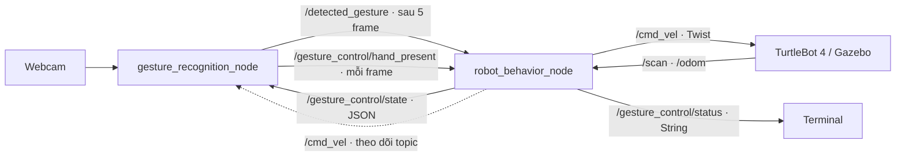

# Bài 6 — TurtleBot 4 Hand Gesture Control

Package ROS 2: `ttbot4_handges_control`

Package này chạy chung trong **một launch**:

- Gazebo với world `gesture_arena`, vùng trống khoảng 10 × 10 m;
- webcam laptop/USB, OpenCV và MediaPipe Gesture Recognizer;
- sáu cử chỉ: Wave, Pointing Up, Victory, Thumb Up, Open Palm, Closed Fist;
- chọn hành vi, xác nhận, thực hiện và dừng robot qua ROS 2;
- cửa sổ webcam hiển thị cử chỉ, độ tin cậy và trạng thái điều khiển.

Không cần chạy Nav2, YOLO hoặc package bài 5 để dùng bài này.

## 1. Cài đặt lần đầu — copy toàn bộ khối này

Yêu cầu Ubuntu 22.04, ROS 2 Humble, webcam và Conda environment `hri`
**dùng Python 3.10** đã được tạo. Build bằng Python hệ thống của ROS;
các thư viện AI được lấy từ Conda khi launch node webcam.

```bash
cd ~/ur_robot_drawing

source ~/miniconda3/etc/profile.d/conda.sh
conda activate hri
source /opt/ros/humble/setup.bash

sudo apt update
sudo apt install -y \
  ros-humble-turtlebot4-simulator \
  ros-humble-irobot-create-nodes \
  python3-colcon-common-extensions \
  python3-rosdep \
  curl

python -m pip install -r ttbot4_handges_control/requirements.txt
rosdep install --ignore-src --from-paths ttbot4_handges_control -r -y

mkdir -p "$HOME/.cache/mediapipe"
curl --fail --location --retry 3 \
  'https://storage.googleapis.com/mediapipe-models/gesture_recognizer/gesture_recognizer/float16/1/gesture_recognizer.task' \
  -o "$HOME/.cache/mediapipe/gesture_recognizer.task"

/usr/bin/colcon build --packages-select ttbot4_handges_control --symlink-install
```

Không dùng `pip install --user` trong Conda. Model chỉ tải một lần, sau đó
nhận diện chạy tại máy, không cần kết nối mạng. Nếu môi trường `hri` đã có
`opencv-python` hoặc `opencv-python-headless`, tránh giữ nhiều gói cùng cung cấp
module `cv2`; package này dùng `opencv-contrib-python` có hỗ trợ GUI.

## 2. Chạy toàn bộ bài — copy toàn bộ khối này

Dừng các launch Gazebo/Nav2/teleop cũ bằng `Ctrl+C`. Đặt webcam sao cho thấy rõ
một bàn tay, ánh sáng đủ và nền ít nhiễu. Mở terminal mới:

```bash
cd ~/ur_robot_drawing

source ~/miniconda3/etc/profile.d/conda.sh
conda activate hri
source /opt/ros/humble/setup.bash

/usr/bin/colcon build --packages-select ttbot4_handges_control --symlink-install
source install/setup.bash
export ROS_LOCALHOST_ONLY=1

ros2 launch ttbot4_handges_control coursework.launch.py \
  camera_index:=0 \
  show_window:=true
```

Gazebo GUI và cửa sổ **TurtleBot 4 | Hand Gesture Control** sẽ mở. Không chạy thêm publisher
`/cmd_vel` trong lúc demo. Webcam là camera thật của laptop, không phải OAK-D
mô phỏng trên robot.

Mặc định dùng TurtleBot 4 **Lite** để giảm tải camera mô phỏng không cần thiết.
Có thể thêm `model:=standard` nếu muốn dùng bản Standard.

Robot xuất hiện trực tiếp trên sàn, **không có dock và không cần undock**.
Robot vẫn đứng yên khi launch; chọn cử chỉ đủ 5 frame rồi xác nhận bằng ngón
cái đủ 5 frame để bắt đầu hành vi ngay. Khi chưa có `/scan` và `/odom`, lệnh
sẽ bị từ chối; chờ **Sensors: READY** rồi chọn và xác nhận lại.

## 3. Demo bằng cử chỉ — không cần bàn phím điều khiển

| Cử chỉ | Giá trị `/detected_gesture` | Hành vi |
|---|---|---|
| Vẫy bàn tay trái–phải | `Wave` | Chọn xoay chào: trái, phải, về hướng ban đầu |
| Giơ một ngón trỏ | `Pointing_Up` | Chọn tiến 0.4 m rồi lùi 0.4 m, lặp **4 cặp** |
| Giơ hai ngón | `Victory` | Chọn chạy một vòng tròn, bán kính 0.6 m |
| Giơ ngón cái | `Thumb_Up` | Xác nhận hành vi đang chọn |
| Xòe bàn tay đứng yên | `Open_Palm` | Dừng, giữ lựa chọn để có thể xác nhận lại |
| Nắm tay | `Closed_Fist` | Hủy hành vi và xóa lựa chọn, về chờ |

Ví dụ chạy tiến–lùi:

1. Đợi **BEHAVIOR NODE** ở thanh dưới chuyển xanh và **Sensors: READY**.
2. Giơ **một ngón trỏ**; nhìn thanh **CONFIRMATION** tăng từ `1/5` đến `5/5`.
   Khi đủ 5 frame, mục **ROBOT FEEDBACK** phải hiện **Forward / back x4**
   và trạng thái **SELECTED**. Robot vẫn đứng yên.
3. Đổi sang **ngón cái**; bộ đếm bắt đầu lại từ `1/5`. Đủ `5/5`, robot chuyển
   thẳng sang **RUNNING**, không có bước chuẩn bị rời dock.
4. Khi đã thấy **RUNNING**, bạn có thể **hạ tay hoặc đưa tay ra khỏi webcam**.
   Robot vẫn thực hiện hành vi đã xác nhận; nhãn `None` hoặc `Hand: NONE`
   không hủy lệnh. Đưa tay lại và xòe tay để dừng, hoặc nắm tay để hủy.
5. Robot chạy đủ bốn cặp tiến–lùi rồi hiển thị **COMPLETED**.
6. Muốn chạy tiếp, chọn lại hành vi bằng cử chỉ tương ứng đủ 5 frame, rồi
   đổi sang ngón cái đủ 5 frame để xác nhận lại.

**Quy tắc 5 frame:** cùng một nhãn hợp lệ, đạt ngưỡng tin cậy, trong **5 frame
được xử lý liên tiếp**. Ví dụ `Victory, Victory, None, Victory` sẽ có bộ đếm
`1, 2, 0, 1`; không cộng dồn các frame bị ngắt quãng. Đổi nhãn cũng đếm lại.
Ở tốc độ xử lý khoảng 15 FPS, quá trình này mất khoảng 0.3 giây; máy chạy chậm
sẽ cần giữ tay lâu hơn. Quan sát `5/5` và phản hồi robot để biết lệnh đã nhận.
**Open Palm và Closed Fist có hiệu lực ngay ở frame hợp lệ đầu tiên**, không
đợi đủ 5 frame để dừng/hủy.

Với Wave, xòe bàn tay và vẫy ngang trái–phải ít nhất hai lần đổi chiều trong
1.5 giây; biên độ khoảng 8% chiều rộng ảnh mỗi chặng. Tiếp tục vẫy đến khi
thấy `SELECTED: greet`, sau đó đổi sang ngón cái. Khi vẫy, `Open_Palm` có thể
xuất hiện trước `Wave`; điều này chỉ dừng robot và vẫn giữ lựa chọn.

**Wave là nhận diện chuyển động theo thời gian từ landmark cổ tay**,
kết hợp nhãn Open Palm của MediaPipe. Nó không phải nhãn tĩnh có sẵn trong
model. Độ tin cậy hiển thị khi Wave là điểm của Open Palm, không phải xác suất
của một model Wave riêng.

## 4. Đọc giao diện và kết nối giữa các node

Cửa sổ có bố cục 1280 × 820, có thể kéo đổi kích thước:

| Vùng | Cách đọc |
|---|---|
| **CAMERA + HAND TRACKING** bên trái | Video webcam giữ đúng tỉ lệ; 21 khớp tay được nối thành các ngón với màu riêng. |
| **RECOGNIZED GESTURE** bên phải | Cử chỉ đang nhận diện và điểm AI. Chưa đủ 5 frame thì chưa gửi lệnh chọn/xác nhận. |
| **CONFIRMATION** | Năm ô tiến trình; `5/5` là đủ điều kiện gửi nhãn. Dừng/hủy hiển thị màu đỏ và xử lý ngay. |
| **Sent** | Nhãn thực sự đã publish sau bộ lọc; có thể là `No gesture` trong lúc đang đếm. |
| **ROBOT FEEDBACK** | Lựa chọn và trạng thái do **node robot trả về**, dùng để xác nhận robot đã tiếp nhận. |
| **Sensors / Mode / LiDAR / Hand** | Cảm biến sẵn sàng, chế độ `DIRECT`, khoảng cách vật cản và tracker bàn tay: `OK` khi thấy tay, `NONE` khi không thấy tay; `Camera: OFF` nếu không còn frame xử lý. |
| **CMD_VEL** | Lệnh vận tốc đọc trực tiếp từ topic, không phải vận tốc đo được của robot. |
| Thanh kết nối dưới cùng | Webcam → Gesture Node → Behavior Node → Cmd_vel Topic; xanh khi có kết nối/dữ liệu mới, đỏ khi chưa có hoặc quá hạn. |

Màu xanh ở **BEHAVIOR NODE** cần cả subscriber của topic cử chỉ và phản hồi
robot còn mới. Nếu quá 1.5 giây không có phản hồi, giao diện báo **OFFLINE**
và ẩn các giá trị cũ bằng `--`. **CMD_VEL TOPIC** chỉ xanh khi vừa nhận được
message trong 1.5 giây; màu xanh này không có nghĩa robot đang chạy.

Luồng ROS giữa hai node:



`/gesture_control/state` đưa lựa chọn, trạng thái và cảm biến trở lại cửa
sổ; `/gesture_control/status` vẫn giữ dạng chuỗi để kiểm tra bằng terminal.
Sau khi đủ 5 frame, kiểm tra cả **Sent** và **ROBOT FEEDBACK**, vì robot có
thể từ chối thực hiện nếu cảm biến chưa sẵn sàng hoặc có vật cản.

Dấu hiệu đúng: robot đứng yên ở **SELECTED**, chỉ chạy sau xác nhận;
**COMPLETED** không tự kích hoạt lại khi vẫn giữ ngón cái. Xòe tay/nắm tay
làm dừng ngay. **Đưa tay ra khỏi ảnh không dừng hành vi đã xác nhận**;
robot vẫn dừng khi hoàn tất, gặp vật cản hoặc nhận lệnh dừng/hủy.
Mất luồng xử lý camera khoảng 2 giây vẫn làm dừng với **SIGNAL_LOST**.

## 5. Kiểm tra topic — mở Terminal 2 và copy khối này

Giữ launch ở Terminal 1 đang chạy:

```bash
cd ~/ur_robot_drawing
source ~/miniconda3/etc/profile.d/conda.sh
conda activate hri
source /opt/ros/humble/setup.bash
source install/setup.bash
export ROS_LOCALHOST_ONLY=1

ros2 node list
ros2 topic echo /detected_gesture
```

`Ctrl+C` để kết thúc lệnh xem topic, rồi kiểm tra trạng thái:

```bash
ros2 topic echo /gesture_control/status
```

Xem phản hồi đầy đủ đang dùng cho giao diện:

```bash
ros2 topic echo /gesture_control/state
```

Các lệnh kiểm tra khác, chạy từng lệnh:

```bash
ros2 topic echo /cmd_vel
ros2 topic hz /gesture_control/hand_present
ros2 topic hz /scan
ros2 topic hz /odom
```

Kết quả đúng: có hai node `/gesture_recognition_node`, `/robot_behavior_node`;
`/detected_gesture` có dữ liệu gần 15 Hz tùy tốc độ webcam và máy. Nhãn `None`
nghĩa là chưa đủ ổn định, điểm thấp, không thấy tay hoặc không thuộc sáu cử chỉ
điều khiển. Ở trạng thái chờ/dừng, vận tốc publish bằng 0.

## 6. Cơ chế chống nhiễu và dừng

- Cử chỉ chọn/xác nhận cần **5 frame liên tiếp**, điểm AI tối thiểu 0.65 ở mỗi frame.
- Node điều khiển xử lý theo lần đổi nhãn; giữ nguyên cử chỉ không lặp lệnh.
- Open Palm và Closed Fist đi thẳng qua bộ lọc 5 frame; khi node nhận được
  nhãn, nó publish vận tốc 0 ngay.
- Watchdog dùng thời gian thực, không phụ thuộc `/clock` mô phỏng và **không
  phụ thuộc việc cử chỉ có đủ 5 frame hay không**. Sau mỗi frame suy luận,
  node camera publish `/gesture_control/hand_present`, kể cả khi nhãn là `None`.
- Khi đang chạy, không có frame xử lý mới quá `signal_timeout` (2 giây)
  thì dừng với `SIGNAL_LOST`. Camera lỗi, node treo hoặc suy luận bị kẹt đều
  không thể giữ robot chạy bằng một heartbeat timer giả.
- Sau khi xác nhận, không cần giữ tay trước camera. Frame không có tay vẫn
  là heartbeat hợp lệ; `Hand: NONE` chỉ thông báo không có bàn tay trong ảnh.
  Robot tiếp tục hành vi đến khi hoàn tất hoặc nhận lệnh dừng/hủy. Bộ lọc
  5 frame vẫn áp dụng khi chọn/xác nhận lần tiếp theo.
- Lựa chọn chờ xác nhận được giữ tối đa `selection_timeout` (10 giây), giúp
  đủ thời gian đổi từ cử chỉ chọn sang ngón cái. Quá hạn hiện `SELECTION_EXPIRED`.
  Trạng thái chờ, đã dừng hoặc đã hoàn tất không bị ghi đè liên tục thành
  `SIGNAL_LOST`.
- Mất odometry hoặc LiDAR quá 1 giây thì dừng.
- Có vật trong khoảng 0.4 m từ LiDAR ở bất kỳ hướng nào, hoặc scan có quá
  nhiều giá trị lỗi, thì dừng.
- Chuyển động đo bằng `/odom`: quãng đường cho tiến–lùi, góc quay tích lũy cho
  vòng tròn và chào. Mỗi lượt còn có giới hạn thời gian thực 120 giây.
- Sau dừng do mất tín hiệu/vật cản, robot không tự chạy tiếp; phải chọn lại và
  xác nhận. Open Palm giữ lựa chọn nhưng vẫn cần một lần xác nhận mới.

World mặc định đủ rộng cho các chuyển động này. Bộ chặn LiDAR dừng robot,
không lập đường tránh vật cản. Khi thay world, vẫn phải chọn vùng trống phù hợp.
Độ trễ dừng thực tế phụ thuộc webcam, suy luận, ROS và động lực học mô phỏng;
kiểm thử dừng tại tốc độ mặc định trước khi thay tham số.

## 7. Tham số và cách chạy khác

Tham số chuyển động/nhận diện nằm trong `config/gestures.yaml`:

| Tham số | Mặc định | Ý nghĩa |
|---|---:|---|
| `confidence` | 0.65 | Ngưỡng nhận diện |
| `confirm_frames` | 5 | Số frame liên tiếp để chấp nhận cử chỉ chọn/xác nhận |
| `fps` | 15 | Tần số xử lý webcam mục tiêu |
| `linear_speed` | 0.15 m/s | Tốc độ tiến/lùi và chạy tròn |
| `angular_speed` | 0.5 rad/s | Tốc độ xoay chào |
| `travel_distance` | 0.4 m | Quãng đường mỗi chặng tiến hoặc lùi |
| `circle_radius` | 0.6 m | Bán kính vòng tròn |
| `greeting_angle` | 0.5 rad | Góc chào về mỗi bên |
| `signal_timeout` | 2.0 s | Thời gian tối đa không có frame suy luận mới |
| `selection_timeout` | 10.0 s | Thời gian giữ lựa chọn chờ xác nhận |
| `sensor_timeout` | 1.0 s | Thời gian mất dữ liệu cảm biến cho phép |
| `stop_distance` | 0.4 m | Khoảng cách chặn LiDAR |
| `motion_timeout` | 120 s | Giới hạn thời gian một lượt thực hiện hành vi |

Đổi webcam: thêm `camera_index:=2` nếu camera mong muốn ở `/dev/video2`.
Chỉ chạy hai node với simulation **đã mở sẵn**, đúng topic và không có node
điều khiển vận tốc khác:

```bash
ros2 launch ttbot4_handges_control coursework.launch.py simulation:=false
```

Tắt cửa sổ ảnh khi chỉ cần xem topic: thêm `show_window:=false`; node vẫn đọc
webcam. Đổi model bằng `model_path:=/duong/dan/gesture_recognizer.task`.
Muốn giảm tải GPU, thêm `headless:=true` để chạy Gazebo không có GUI;
cửa sổ webcam vẫn hiển thị bình thường.

## 8. Xử lý lỗi thường gặp

| Hiện tượng | Kiểm tra và xử lý |
|---|---|
| Thiếu `.task` | Chạy lại khối tải model ở mục 1 hoặc truyền đúng `model_path`. |
| `No module named mediapipe` | Activate `hri`, cài requirements và kiểm tra Python 3.10. |
| Không mở được webcam | Kiểm tra `ls /dev/video*`, đổi `camera_index`, đóng ứng dụng đang chiếm camera. |
| Lỗi Qt/xcb khi mở cửa sổ | Dùng terminal desktop có `DISPLAY`; kiểm tra chỉ có một bản OpenCV GUI trong Conda. |
| Webcam có hình, nhãn luôn `None` | Đưa cả bàn tay vào ảnh, tăng ánh sáng, giữ cử chỉ đến khi đủ `5/5`; đổi nhãn/mất tay sẽ đếm lại. |
| `SENSORS_NOT_READY` | Chờ Gazebo tải xong; kiểm tra `/scan`, `/odom`; chọn và xác nhận lại. |
| `SIGNAL_LOST` khi robot đang chạy | Không có frame suy luận mới trong 2 giây. Kiểm tra webcam/node camera, Hz của `/gesture_control/hand_present`, giảm tải bằng `headless:=true`. |
| Nhãn `None`/bộ đếm chạy lại nhưng `Hand: OK` | Chưa đủ độ ổn định cho lệnh mới; hành vi đã xác nhận vẫn được tiếp tục, kể cả khi `Hand: NONE`. |
| `SELECTION_EXPIRED` | Đã quá 10 giây chưa xác nhận. Đổi cử chỉ rồi chọn lại và xác nhận bằng ngón cái đủ 5 frame. |
| `OBSTACLE_STOP` / `SAFETY_STOP` | Kiểm tra vật gần robot, scan/odom có còn cập nhật và Gazebo có bị pause không. |
| Robot nhận vận tốc nhưng không chạy | Kiểm tra controller Gazebo đã sẵn sàng và có publisher `/cmd_vel` khác hay không. |
| Có node bị thoát | Launch sẽ đóng cả bài; xem lỗi đầu tiên trong terminal rồi chạy lại. |

Không cần `rqt_image_view` hay `cv_bridge` vì webcam được đọc trực tiếp bằng OpenCV.

## 9. Topic và file chính

| Topic/action | Kiểu | Nội dung |
|---|---|---|
| `/gesture_control/hand_present` | `std_msgs/msg/Bool` | Heartbeat sau từng frame suy luận: có/không thấy tay, độc lập nhãn cử chỉ |
| `/detected_gesture` | `std_msgs/msg/String` | Nhãn đã lọc, publish liên tục |
| `/gesture_control/state` | `std_msgs/msg/String` | JSON phản hồi để đồng bộ giao diện với robot |
| `/gesture_control/status` | `std_msgs/msg/String` | Trạng thái chọn/chạy/dừng |
| `/cmd_vel` | `geometry_msgs/msg/Twist` | Lệnh vận tốc |
| `/odom` | `nav_msgs/msg/Odometry` | Đo chuyển động |
| `/scan` | `sensor_msgs/msg/LaserScan` | Khoảng cách vật cản |

- `launch/coursework.launch.py`: chạy toàn bộ bài.
- `launch/spawn_robot.launch.py`: tạo robot trên sàn, không tạo dock.
- `config/gestures.yaml`: tham số nhận diện và chuyển động.
- `worlds/gesture_arena.sdf`: world trống, không tải asset Fuel.
- `ttbot4_handges_control/gesture_recognition_node.py`: webcam, AI và overlay.
- `ttbot4_handges_control/gestures.py`: lọc 5 frame liên tiếp và nhận chuyển động Wave.
- `ttbot4_handges_control/display.py`: dashboard webcam, khung xương tay và kết nối ROS.
- `ttbot4_handges_control/robot_behavior_node.py`: ROS I/O, cảm biến và lệnh vận tốc trực tiếp.
- `ttbot4_handges_control/control.py`: máy trạng thái, hành vi và watchdog.
- `test/`: kiểm thử chọn/xác nhận, chuyển động, nhiễu, mất tín hiệu và chạy không cần dock.

Chạy kiểm thử từ thư mục workspace:

```bash
source /opt/ros/humble/setup.bash
PYTHONPATH="$PWD/ttbot4_handges_control:$PYTHONPATH" \
  PYTEST_DISABLE_PLUGIN_AUTOLOAD=1 ROS_LOCALHOST_ONLY=1 ROS_DOMAIN_ID=83 \
  /usr/bin/python3 -m pytest -q ttbot4_handges_control/test
```

Tham khảo: [MediaPipe Gesture Recognizer — Python](https://ai.google.dev/edge/mediapipe/solutions/vision/gesture_recognizer/python),
[các nhãn model có sẵn](https://ai.google.dev/edge/mediapipe/solutions/vision/gesture_recognizer),
[TurtleBot 4 Simulator](https://turtlebot.github.io/turtlebot4-user-manual/software/turtlebot4_simulator.html).
